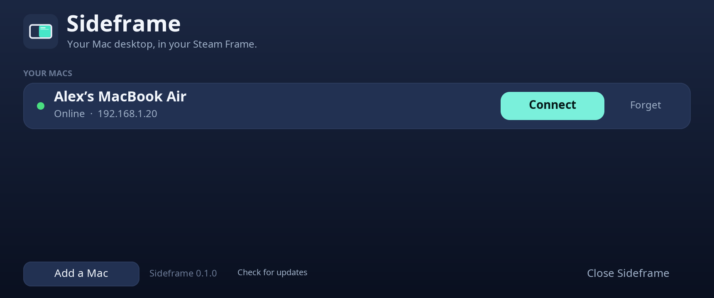
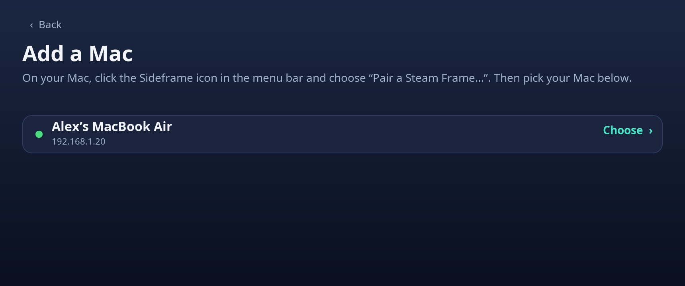
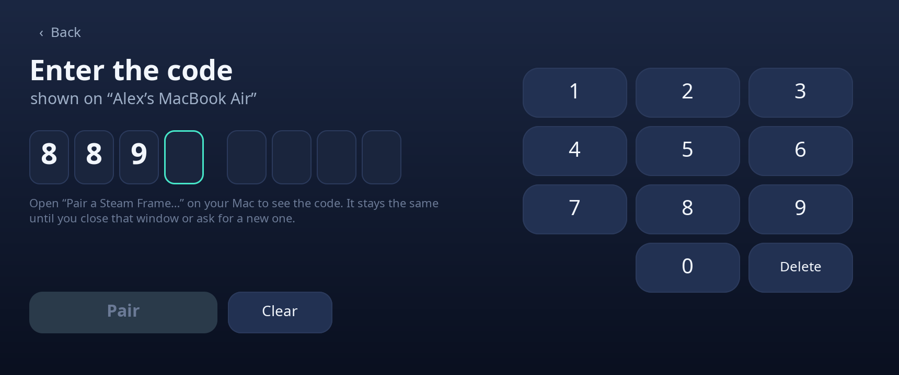
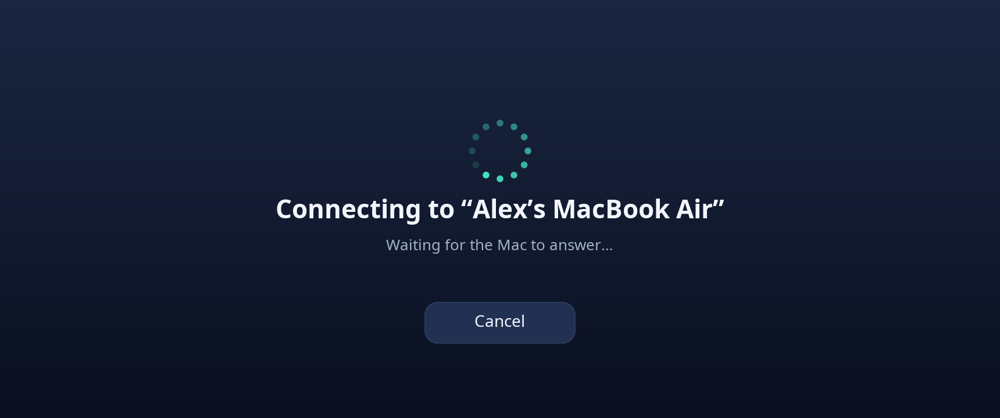

# Sideframe

Your Mac's desktop, in your Steam Frame — as a tab in the SteamVR dashboard.

Sideframe mirrors your Mac's screen to the headset with low latency, hardware video decoding and encrypted transport, and forwards your
pointer, a physical/Bluetooth keyboard, and the SteamVR keyboard back to the Mac.

> Sideframe is an independent open-source project. It is not affiliated with or endorsed by Apple or Valve.
> "Mac" and "Steam Frame" are used only to describe what it works with.

## Screenshots

The Sideframe tab's screens (rendered from the app's own UI code with sample data):

| Home | Add a Mac | Enter the code | Connecting |
|---|---|---|---|
|  |  |  |  |

Once connected, the tab shows only your Mac's screen.

## How it works

```
Mac:  ScreenCaptureKit → VideoToolbox HEVC → encrypted UDP ─────────────┐
Frame: UDP → loss repair → V4L2 hardware decode → dmabuf → Vulkan → SteamVR dashboard tab
                    pointer / keyboard ← encrypted UDP ← overlay events + evdev keyboards
```

* No CPU copies of video on the Frame (decoder buffers are imported straight into Vulkan).
* Everything on the wire is ChaCha20-Poly1305 encrypted with a per-pair key; see [docs/PROTOCOL.md](docs/PROTOCOL.md) and [SECURITY.md](SECURITY.md).
* The picture is sized from the headset's resolution, not hard-coded, so any Mac display works.
* The Frame program links only libsodium, freetype and the Vulkan/OpenVR runtime — no ffmpeg — so SteamOS updates to system video libraries can't break it.

## Requirements

* **Mac:** macOS 13+ (ScreenCaptureKit). Same local network as the Frame.
* **Frame:** SteamOS on the Steam Frame with SteamVR installed (the prebuilt download needs nothing else; building from source needs the tools listed under Install).
  The OpenVR headers ship with SteamVR (`/opt/steamvr/tools/hellovr_vulkan_linux/...`); override with `OPENVR_INC=` / `OPENVR_LIB=`.

## Install

Download both files from the [latest release](../../releases/latest).

**1. Mac** — `sideframe-mac-X.zip`

```sh
unzip sideframe-mac-*.zip && cd sideframe-mac-* && ./install.sh
```

This puts Sideframe in `~/Applications` and opens it (menu-bar icon). Allow **Screen Recording** and **Accessibility** when macOS asks.
The app is ad-hoc signed, not notarized; the installer clears the download quarantine flag. If you rather open it by hand, right-click → Open.

**2. Steam Frame** — `sideframe-frame-X-aarch64.tar.gz` (in Desktop Mode: open a terminal)

```sh
tar xzf sideframe-frame-*.tar.gz && cd sideframe-frame-* && ./install.sh
```

No root, nothing system-wide: it installs into `~/.local` and adds a "Sideframe" entry to the app list. `./install.sh --uninstall` removes it.
To launch it from the Frame's library, add Sideframe as a non-Steam game.

**Build from source instead:** `git clone` the repo, then `cd mac && ./install.sh` and `cd frame && ./install.sh` — each builds first if there is no
prebuilt program. Build tools: Mac needs Apple's command-line tools (`xcode-select --install`); the Frame needs `gcc make pkg-config glslc` and
the dev packages for libsodium, freetype2, vulkan and wayland-client (no ffmpeg needed).

Maintainers: `scripts/package-frame.sh` (on a Frame) and `scripts/package-mac.sh` (on a Mac) build the release downloads into `dist/`.

## Pairing (no SSH, no config files)

1. On the Mac, choose **Pair a Steam Frame…** in the Sideframe menu-bar icon. It shows an 8-digit code (it only changes when you reopen the
   window or click *New Code*).
2. On the Frame, open the Sideframe tab in the SteamVR dashboard → **Add a Mac** → pick your Mac → type the code.
3. Press **Connect**. Close the tab with the **Close** button under it in the dashboard.

## Using it

* Point the laser at the tab to move the Mac's pointer; click, right-click and scroll work.
* The keyboard button under the tab opens the SteamVR keyboard. A physical or Bluetooth keyboard types into the Mac while the laser is on the tab.
* `sideframe --help`-style options: `--scale F` (force a fixed fraction of the Mac's resolution), `--max-fps N`, `--idle-exit SECONDS`.

## Settings

On the Frame's home screen, **Settings**:
* **Picture — Sharp or Efficient.** Efficient sends a slightly smaller picture with fewer updates per second and asks the Mac for less video data: cooler and quieter.
* **Start with SteamVR** (off by default). Installs a small user service so the tab is always in the dashboard; turning it off removes it.
* **Temperature protection.** Above 85 °C Sideframe eases off by itself (fewer updates, less video data) and returns to normal below 80 °C.

## Updates

The Frame's home screen shows its version and has a **Check for updates** button. It makes one small request (a text file in this repository,
`latest.txt`) only when you press it — never in the background — and tells you if a newer release exists. Download it from the releases page.
Forks can point it elsewhere: `make SIDEFRAME_UPDATE_URL=https://…/latest.txt` (empty disables the button).

## Known limits

* One Mac display (the main one) is mirrored; no virtual displays.
* Not an on-screen keyboard replacement for third-party keyboard apps yet (they type into the compositor focus, not overlays).
* The Mac app is ad-hoc signed; a Developer ID build would keep permissions across updates.

## Contributing

See [CONTRIBUTING.md](CONTRIBUTING.md). Bugs and pull requests welcome.

## License

MIT — see [LICENSE](LICENSE). Bundled font: Noto Sans (SIL OFL, see `frame/assets/fonts/LICENSE`).
