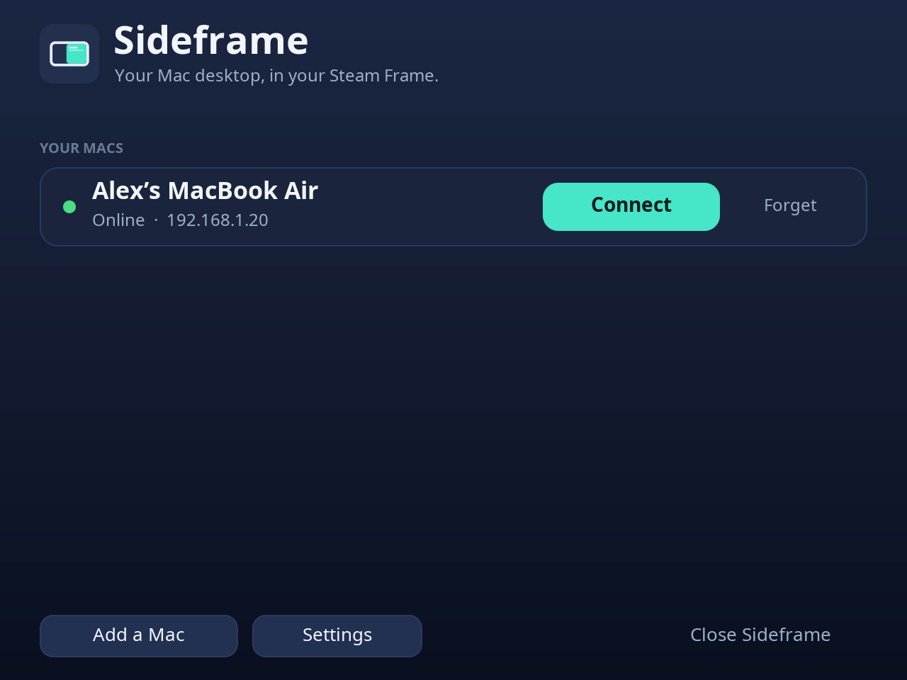
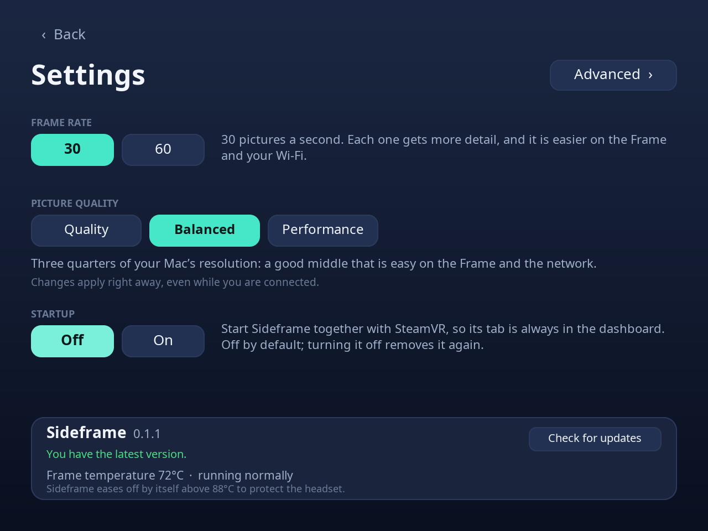
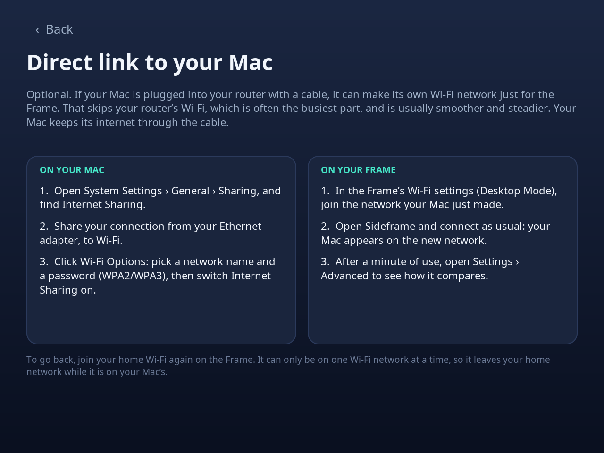

# Sideframe

**See your Mac's screen inside your Steam Frame.**

Sideframe adds a "Sideframe" tab to the SteamVR dashboard. Open it and your Mac's desktop is right there in front of you. Point at it with
the controller to move the mouse, and type with a real keyboard, a Bluetooth keyboard or the SteamVR keyboard.

| | | |
|---|---|---|
|  |  |  |

> Sideframe is a free, open-source hobby project. It is not made by or connected to Apple or Valve. "Mac" and "Steam Frame" are just names of the
> things it works with.

> **Beta.** Sideframe is in beta. It works, but it is new, and you may hit rough edges. If something breaks, please
> [open an issue](../../issues) and say what you were doing.

## What you need

* A **Mac** running macOS 13 or newer.
* A **Steam Frame** with SteamVR.
* Both on the **same home network** (Wi-Fi is fine; a cable on the Mac is even better).

## Install (about five minutes)

Download the two files from the [latest release](../../releases/latest) — one for the Mac, one for the Frame.

**1. On your Mac** — unzip `sideframe-mac-….zip`, open Terminal in that folder and run:

```sh
./install.sh
```

Sideframe appears as an icon in the menu bar. macOS will ask for two permissions: **Screen Recording** (so it can show your screen) and
**Accessibility** (so the Frame can move the mouse and type). Say yes to both. If macOS asks you to quit and reopen the app, do that.

**2. On your Frame** — switch to Desktop Mode, unpack `sideframe-frame-….tar.gz`, open a terminal in that folder and run:

```sh
./install.sh
```

Nothing is installed system-wide and no password is needed. Sideframe shows up in the app list; add it to Steam as a non-Steam game if you want it in your library.

## Connect them (once)

1. On the Mac, click the Sideframe menu-bar icon and choose **Pair a Steam Frame…**. An 8-digit code appears.
2. On the Frame, open the **Sideframe tab** in the SteamVR dashboard, press **Add a Mac**, pick your Mac and type the code.
3. Press **Connect**. Your Mac's screen appears.

After that, connecting is one button. To close Sideframe, use the **Close** button under the tab.

## Using it

* **Point and click** with the controller laser. Right-click and scrolling work too.
* **Type** with any keyboard while the laser is on the tab, or press the keyboard button under the tab for the SteamVR keyboard.
* **Settings and Disconnect:** two small buttons sit just to the right of the picture, never over it, and brighten when the laser gets close. The **gear** opens
  Settings (and lets you go **Back to Mac**); the **monitor with a cross** disconnects. The disconnect button only appears while you're connected to a Mac. Your Mac pauses while the menu is open.

## Settings

* **Frame rate: 30 or 60.** 60 is smoother but needs a good connection and runs warmer. 30 is easier on everything.
* **Picture quality.** *Quality* shows your Mac at its full resolution, *Balanced* at three quarters and *Performance* at half. Higher is
  sharper but warmer and needs more from your Wi-Fi. It changes immediately, even while you're connected.
* **Start with SteamVR.** Keeps the Sideframe tab in the dashboard all the time. Off by default.
* **Staying cool.** The Frame eases off by itself if it gets hot, so you don't have to watch it.

### Advanced

**Settings › Advanced** shows how your connection is doing (delay, how many packets Wi-Fi lost, what your Mac is sending) and compares it with
the last time you used a different network. It remembers each network on your Frame only — nothing is sent anywhere.

## Make it smoother: a direct link (optional)

Wi-Fi is the most common reason for a choppy picture. If your Mac is plugged into your router with a cable, you can have it make its own little
Wi-Fi network just for the Frame, so the video skips your router's busy Wi-Fi.

1. **On the Mac:** System Settings › General › Sharing › **Internet Sharing**. Share from your Ethernet adapter, to Wi-Fi. Under Wi-Fi Options pick
   a name and a password, then switch it on.
2. **On the Frame:** join that network (in Desktop Mode, in the Wi-Fi settings).
3. Open Sideframe as usual. Your Mac shows up on the new network.

The Frame leaves your home Wi-Fi while it's on your Mac's network (it can only be on one), but it still gets internet through your Mac's cable. To go back,
join your home Wi-Fi again. Sideframe's **Settings › Advanced** screen shows the same steps and, after a minute of use, compares the two connections.
(In one test this turned a connection with constant hiccups into one with none.)

## If something isn't right

* **The Frame doesn't find my Mac.** Is Sideframe's icon in the Mac's menu bar? Are the Mac and the Frame on the same Wi-Fi network? (If you use a guest
  network or a router with "client isolation", devices can't see each other.)
* **Picture is choppy or blurry.** Try 30 frames per second, or *Balanced*. Look at Settings › Advanced: a high delay or lots of re-sent packets means the
  Wi-Fi is the problem, and the direct link above is the best fix.
* **Mouse or typing does nothing.** On the Mac: System Settings › Privacy & Security › Accessibility — Sideframe must be on.
* **The Mac screen is black or says it can't record.** Same place, under Screen Recording.
* **After I updated the Mac app, it asks for permissions again.** That is expected: the app isn't signed with an Apple developer certificate, so macOS treats each
  update as a new app. `./install.sh` clears the old entries for you. If you replace the app by hand, remove "Sideframe" from both lists first, then add it again.
* **It feels warm.** Choose *Performance* or 30 fps. Sideframe also slows itself down when the Frame gets hot.

## Updates

**Settings** shows the Frame's version and has a **Check for updates** button. It only looks when you press it — never in the background — and just tells
you if a newer version exists. Download it from the releases page and run `./install.sh` again.

## Good to know

* Only your Mac's **main display** is shown. There are no extra virtual displays yet.
* On-screen keyboards from other apps don't work in the tab yet.
* Everything between your Mac and your Frame is encrypted and only works between devices you paired. See [SECURITY.md](SECURITY.md).

## For developers

The Frame app is C, the Mac app is Swift (no Xcode project needed). Building from source, the wire protocol, and how to contribute are covered in
[CONTRIBUTING.md](CONTRIBUTING.md) and [docs/PROTOCOL.md](docs/PROTOCOL.md).

```
Mac:   screen capture → hardware video encoder → encrypted UDP ───────────┐
Frame: UDP → repair lost packets → hardware decoder → GPU → SteamVR tab
       mouse and keyboard ← encrypted UDP ← laser + keyboards
```

Building from source, short version: `git clone` this repo, then `cd mac && ./install.sh` on the Mac and `cd frame && ./install.sh` on the Frame (each builds first
if there is no prebuilt program). The Mac needs Apple's command-line tools (`xcode-select --install`). The Frame needs `gcc make pkg-config glslc` and the
development packages for libsodium, freetype2, vulkan and wayland-client.

## License

MIT — see [LICENSE](LICENSE). Bundled font: Noto Sans (SIL OFL, see `frame/assets/fonts/LICENSE`).
